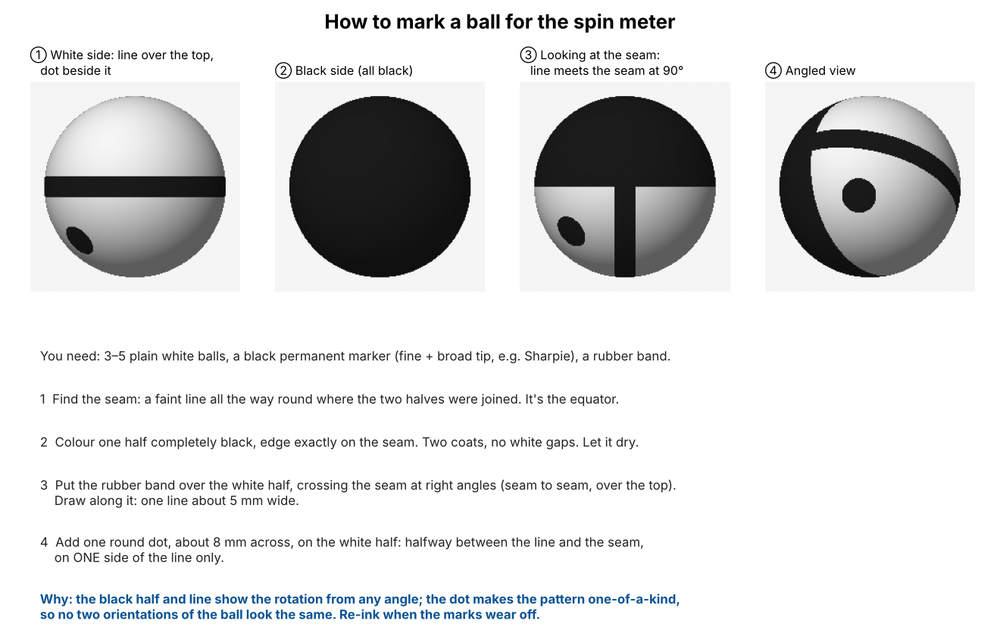

# Experiment 02 — Spin meter

**Goal:** measure a table tennis ball's spin, **rate (RPM) and axis**, from one phone's
slow-motion video, like a baseball spin-rate tracker. This is now the first step of the
project: before coaching anything, the app must know how much spin a serve really had.

## Prior art

| System | How it measures spin | Notes |
|---|---|---|
| Baseball: TrackMan | Doppler radar | No camera |
| Baseball: Rapsodo | Radar + camera reading printed markings on special balls | Special balls needed for the axis |
| **Spinsight** (ESN, Germany, launched Feb 2025) | iPhone 13+ on a net-post holder, **special marked balls**, processed in their cloud | Rotations per second + direction, speed, placement. Needs ≥ 300 lux. Free tier, then €10/month. **Proves the idea works with one phone.** Also a possible reference to check our meter against. |
| SpinDOE (Univ. Tübingen, 2023) | Printed dot pattern, CNN finds dots, fit 3D orientation per frame | Up to 175 rps at 350 FPS, < 1% spin error. Open source (cogsys-tuebingen/spindoe). |
| T-League system (Tamaki et al., 2024) | Reads the ball's printed logo | Median error 0.78 rps on match serves |

## Method (`spinmeter.py`)

1. **Find the ball** in each frame: the region that differs from the background median.
   Both the white and the black parts of a marked ball differ from the background, so
   the whole ball is found.
2. **Normalise:** resample every frame's ball into the same 64×64 patch, centred.
3. **Remove the lighting:** the marking turns with the ball, the light doesn't. A high
   per-pixel percentile over all frames estimates "white under this light"; dividing by
   it leaves only the marking.
4. **3D rotation fit:** treat the visible half of the ball as a sphere. For a candidate
   per-frame rotation (axis + angle), map each surface point of frame *t+1* back to frame
   *t* and compare. Search all axes and angles coarsely (≈ 27,000 candidates on 10 frame
   pairs), then refine the best 8 on all frame pairs. Spin is assumed constant over the
   clip (about 0.1 s), which holds in flight.
5. **Report:** total rps / RPM, axis, and the split into backspin/topspin, sidespin and
   gyro (corkscrew) components, using the flight direction.

`--method 2d` keeps the simpler v1: in-image rotation only, via polar cross-correlation.

## Synthetic test (`spinsim.py`, `sweep.py`)

`spinsim.py` renders a 240 FPS clip of a marked ball (default: one half black, one black
line and one dot; see [Marking the ball](#marking-the-ball)) flying across the frame with a known spin, with motion blur, sensor noise and
lossy MP4 compression. `sweep.py` varies one condition at a time.

Baseline: 30 rps, axis straight at the camera, 40 px ball, 8 px/frame flight, exposure
1/960 s, noise σ = 4. Full results: [`sweep_results.csv`](sweep_results.csv).

| Case | True rps | v1 (2D): in-image part true → measured | v2 (3D) measured | v2 error | v2 axis error |
|---|---|---|---|---|---|
| baseline | 30 | 30.0 → 29.8 | 30.0 | 0.0 | 2.6° |
| slow spin 5 rps | 5 | 5.0 → 3.2 | 4.92 | -0.1 | 3.6° |
| 15 rps | 15 | 15.0 → 15.0 | 15.0 | 0.0 | 2.6° |
| 60 rps (top-player serve) | 60 | 60.0 → 59.2 | 60.0 | 0.0 | 0.0° |
| 100 rps | 100 | 100.0 → 100.0 | 100.0 | 0.0 | 0.0° |
| 130 rps (above the 120 rps limit) | 130 | 130.0 → -109.8 | 110.0 | aliased | — |
| backspin -30 rps | 30 | -30.0 → -30.0 | 30.0 | 0.0 | 2.6° |
| ball 20 px | 30 | 30.0 → 29.7 | 30.0 | 0.0 | 3.6° |
| ball 14 px | 30 | 30.0 → 26.3 | 29.5 | -0.5 | 6.3° |
| ball 70 px | 30 | 30.0 → 29.7 | 30.0 | 0.0 | 0.0° |
| full blur (1/240 s) | 30 | 30.0 → 26.9 | 29.67 | -0.3 | 3.6° |
| full blur, 60 rps | 60 | 60.0 → 60.9 | 58.0 | -2.0 | 3.6° |
| fast flight 20 px/frame | 30 | 30.0 → 29.7 | 30.0 | 0.0 | 2.6° |
| axis tilted 20° | 30 | 28.2 → 1.2 | 30.5 | 0.5 | 1.6° |
| axis tilted 45° | 30 | 21.2 → 6.9 | 30.33 | 0.3 | 2.4° |
| axis tilted 70° | 30 | 10.3 → -3.8 | 29.0 | -1.0 | 1.9° |
| pure sidespin (axis vertical) | 30 | 0.0 → 1.2 | 29.33 | -0.7 | 0.0° |
| side-backspin, axis 40° (typical serve) | 30 | -23.0 → -3.6 | 29.71 | -0.3 | 2.3° |
| side-backspin, full blur | 30 | -23.0 → -14.7 | 28.25 | -1.8 | 7.8° |
| pattern: half + line (no dot) | 30 | 30.0 → 29.9 | 30.0 | 0.0 | 2.6° |
| pattern: half only | 30 | 30.0 → 26.9 | 30.0 | 0.0 | 2.6° |
| pattern: dots | 30 | 30.0 → 27.6 | 30.0 | 0.0 | 3.6° |
| noise 12 | 30 | 30.0 → 28.3 | 30.67 | 0.7 | 3.6° |
| 120 FPS, 30 rps | 30 | 30.0 → 29.7 | 30.0 | 0.0 | 3.6° |
| 120 FPS, 70 rps | 70 | 70.0 → -49.5 | 49.33 | aliased | — |

**Conclusions from synthetic data:**
- **v2 (3D) is accurate to about ±2 rps and ±8° of axis** across ball sizes from
  14 px, full motion blur, any axis, and four marking patterns.
- **v1 (2D) fails as soon as the axis tilts**, for example on a side-backspin serve
  (−23 → −2.6). Use v2.
- **Hard limit: half a turn per frame.** 120 rps at 240 FPS (7,200 RPM), 60 rps at
  120 FPS. Top-player serves measured 14–63 rps, so **240 FPS covers serves**, and 120 FPS
  is borderline. Above the limit the answer is silently wrong (aliased). A future check
  could use the ball's flight curve (Magnus effect) to catch this.
- Speed: about 7 s per clip on a laptop CPU, unoptimised.

**What the synthetic test does *not* cover** (needs real video): imperfect hand-drawn
markings, real ball detection against a cluttered background, specular highlights,
rolling shutter, phone slow-motion encoding, and spin changing during the clip.

## Marking the ball



1. **Find the seam:** a faint line all the way round where the two halves were joined.
   It's the equator.
2. **Colour one half completely black** with a permanent marker, edge on the seam, two
   coats.
3. **Draw one line about 5 mm wide** over the white half, seam to seam, crossing the seam at
   right angles. A rubber band makes a good guide.
4. **Add one dot about 8 mm across** on the white half, between the line and the seam, on
   one side of the line only. Without it, the pattern looks the same after a half turn
   about the white pole. The meter still copes (it fits one rotation across all frames),
   but the dot removes the ambiguity.

Make 3–5 balls and re-ink them when the marks wear off.

## Recording: no table needed

The meter only looks at the ball's flight **just after the racket contact, before the
first bounce** (about 0.1 s, 20–30 frames at 240 FPS). The table doesn't change the spin.
It only matters later, for the outcome of the serve (where it bounces, does it come back).
So an **empty floor next to a wall is fine**, and even easier:

| Item | Setting |
|---|---|
| Space | Stand about 1 m in front of a **plain, mid-tone wall or cloth** (blue, green or grey). Not white, or the white half disappears; not black, or the black half disappears. A table-tennis barrier or a blue/green bed sheet works. |
| Direction | Serve **parallel to the wall**, so the ball flies left-to-right (or right-to-left) across the camera's view. |
| Camera | Tripod about **1–1.5 m from the ball's path**, at contact height, pointing at the wall, square to it. Frame the first 50–80 cm of flight after contact. The ball should be **at least 20 px across** (about 40 px at 1080p and 1.5 m). |
| Mode | Slow-motion **240 FPS**, 1080p if available. Keep the original file. |
| Light | As bright as possible (Spinsight asks for ≥ 300 lux). Daylight by a window or a work lamp aimed at the area. Short exposure = less blur. |
| Motion | Your real serve motion (toss + brush). Start with easy ones: drop the ball and brush under it, then full serves. |
| Bonus check | On the floor, real backspin shows itself: the ball skids, stops or even rolls back toward you after bouncing. |

Don't spin the ball in place (like a top on the floor or the table): the meter finds the
ball by its movement against the background, so it needs a ball in flight.

```bash
.venv/bin/python experiments/02-spin-meter/spinmeter.py serve01.mov --fps 240 --start 120 --end 150
```

Trim each clip to the frames after contact and before the bounce (`--start`, `--end`).

**Checking against a reference:** compare a few serves with Spinsight, or spin a marked
ball at a known speed on a drill or small motor and measure that.

## First real recordings (2026-10-14)

Five clips from a Pixel 8, side view against a plain light wall, marked ball
(half black). Source: shared Drive folder "Table tennis" (not committed).

| Clip | Capture | Notes |
|---|---|---|
| v1, v2, v4 | 60 FPS (v2, v4 in 4K) | Too slow for spin: limit is 30 rps, and heavy blur |
| v3, v5 | **120 FPS** slow motion (saved as 30 FPS playback, 4× slower) | Usable for a first test. Read the real rate from the file's `com.android.capture.fps` tag. |

**Results on v5** (`--fps 120 --roi 280 440 480 360`):

| Segment | Frames | Meter | Fit | Verdict |
|---|---|---|---|---|
| Toss (falling ball) | 296–312 | **0.5 rps, no spin** | 0.895 | ✓ Correct: a legal toss has no spin. The marking is sharp, about 25 px across. |
| After contact | 326–336 | 53 rps "backspin-sidespin-gyro" | 0.66 | ✗ Unreliable: the ball is a streak about 40 px long and the marking can't be read. |

**Why:** indoors the phone keeps the shutter open for most of each frame. A fast serve moves
about 28 px per frame here, so the ball smears by about 17 px, over half its diameter.
The ball also left the frame after about 10 frames, because the phone was in portrait.

**Simulated with the same conditions** (true spin: 30 rps side-backspin, 25 px ball):

| Setting | Meter | Fit |
|---|---|---|
| Like the real clip: 120 FPS, shutter open 60% of the frame | 45 rps **topspin** (wrong) | 0.42 |
| 120 FPS, shutter 15% of the frame (≈ 4× more light) | 29 rps backspin ✓ | 0.76 |
| 240 FPS, same indoor light | 24 rps backspin (too low) | 0.59 |
| **240 FPS + bright light** (shutter ≈ 1/1000 s) | **29.9 rps backspin ✓** | **0.91** |

So the meter now reports `"reliable": false` with a warning when the fit score is below
0.75, instead of a confident wrong number.

### Re-recording checklist

1. **240 FPS** slow motion (Pixel 8: Camera → Slow motion → 1/8×).
2. **Much more light**: daytime outdoors (shade is fine) or right next to a big window;
   indoors, two bright lamps aimed at the ball's path. Target shutter ≈ 1/1000 s or shorter.
   Daylight is often 10–50× brighter than a room.
3. **Landscape orientation**, so a horizontal flight stays in view for 30+ frames.
4. **Camera about 2 m from the ball's path** in landscape 1080p: the ball stays about
   30 px across and the view covers about 2.4 m of flight.
5. Keep the plain wall behind the ball's path (already good), and keep the arm out of the
   ball's path after contact where possible.

## Second recordings (2026-10-14): 240 FPS, landscape — first real spin numbers

Four serves, Pixel 8 slow motion at **240 FPS**, landscape, side-on, plain wall, ball
marked half black (some also with the line). Run fully automatically:

```bash
.venv/bin/python experiments/02-spin-meter/spinmeter.py serve.mp4 --fps 240 --auto --plot pole.png
```

| Clip | Meter (pole method) | RPM | Fit | Hand count (frames between "black side facing camera") | Agrees? |
|---|---|---|---|---|---|
| w1 | **35.7 rps** | 2,140 | 0.71 (just under 0.75) | ≈ 6.5 frames → ≈ 37 rps | ✓ |
| w2 | **31.7 rps** | 1,900 | 0.88 | ≈ 7.2 frames → ≈ 33 rps | ✓ |
| w3 | **17.2 rps** | 1,030 | 0.84 | ≈ 14 frames → ≈ 17 rps (faint marking) | ✓ |
| w4 | **36.0 rps** | 2,160 | 0.90 | ≈ 6.7 frames → ≈ 36 rps | ✓ |

**Spin rate: all four agree with an independent hand count within about 5%.** These are in
the range reported for serves (14–63 rps). The split into backspin / sidespin / gyro is
**not validated yet**: every clip shows a large "gyro" part, which may be real (pendulum
serves often have some) or may come from the camera not being exactly side-on. That needs
a reference: Spinsight, or a ball spun at a known axis and speed.

### What it took to work on real footage

1. **Pole tracking instead of matching surface detail** (`--method pole`, now the
   default). The ball is only about 25 px across and soft from motion blur and
   compression, so fine detail is gone. But two coarse measurements survive: the share
   of the ball that looks black gives how much the black half's pole points at the camera
   (exactly `f = (1 + b_z) / 2` for a hemisphere), and where the dark area sits gives the
   pole's sideways direction. Every rate from 0.5 rps to half the frame rate is then tested
   with a linear fit of a rotating vector, which never loses count of turns. On the
   simulator: within 0.1 rps from 8 to 90 rps, axis within about 5–13°.
2. **Light flicker correction.** Room lights pulse with the mains power. At 240 FPS frames
   alternate brighter/darker in bands, which made the ball detector miss every other
   frame. Each frame's rows are now rescaled to the background brightness.
3. **Automatic flight finding** (`--auto`): the longest track of a small round moving blob
   that travels sideways. Then the steady part after contact is kept, skipping 12 frames
   next to the racket, for at most 40 frames (≈ 0.17 s, before any bounce).
4. **Trajectory smoothing** of the ball centre (the detector sees mostly the black half,
   so raw centres jitter as the ball turns).

### Still to improve

- Light: the room is dim, so the white half is barely brighter than the wall (w3's marking
  is faint). Daylight would give cleaner readings.
- Axis validation against a reference (see above).
- w1 is just under the reliability threshold because its segment still starts near the
  racket.

## Spin type: back, top, side, gyro or no spin

The meter reports the spin as players think of it: by what it does to the flight (the
Magnus effect), relative to the ball's **real 3D flight direction**.

| Output | Meaning |
|---|---|
| `backspin_rps` / `topspin_rps` | rotation about the horizontal axis across the flight: lifts / dips the ball |
| `sidespin_rps` + `sidespin_curves` | rotation about the vertical axis: the ball curves left / right, as seen by the server looking along the flight |
| `gyro_rps` | rotation about the flight direction (corkscrew): no curve |
| `axis_tilt_deg` | the axis seen along the flight: 0° = pure backspin, ±90° = pure sidespin, 180° = pure topspin |
| `spin_type` | label, e.g. "side-backspin (curves right)"; "no spin" below 3 rps |

**Flight direction in 3D:** sideways from the image velocity; toward/away from the camera
from the ball's apparent size, which grows as it approaches (`--hfov`, the camera's
horizontal field of view, converts between them; Pixel 8 ≈ 68°). This matters: if the ball
flies 15° toward the camera and this is ignored, part of the backspin is mislabelled as gyro.
The camera is assumed level (image up = real up).

**Independent physical check:** the ball's real size (40 mm) gives mm per pixel, so the
trajectory gives the real downward acceleration. Gravity alone is 9.8 m/s²; backspin lift
makes it less, topspin more. At serve speeds the effect is only about 1 m/s², close to the
scale uncertainty, so this check is weak.

| Serve | Meter | Back / top | Side | Gyro | Flight toward camera | Fall accel. | Check |
|---|---|---|---|---|---|---|---|
| w1 | side-backspin (curves right) + gyro, 35.7 rps | 22 back | 16 | 23 | −6° | 9.6 | ? (no lift seen); see ground truth below |
| w2 | side-backspin (curves right), 31.7 rps | 24 back | 16 | 13 | −10° | 8.8 | ✓ lift |
| w3 | side-topspin (curves left), 17.2 rps | 9 top | 12 | 8 | +15° | 12.3 | ✓ dip |
| w4 | sidespin (curves right), 36.0 rps | 13 back | 33 | 6 | +7° | 9.6 | ✓ (little lift expected) |

On the simulator, the components come out within about 2 rps for sharp balls and about
7 rps for small, heavily blurred ones.

### Ground truth from the player (2026-10-14)

w1 and w2 were served as **backspin**, w3 as **topspin**, w4 was a serve error.

| Serve | Served | Meter v1 (wall-level black share) | Meter v2 (per-spot lighting reference) |
|---|---|---|---|
| w1 | backspin | side-backspin: 22 back, 16 side, 23 gyro | side-backspin: 17 back, 21 side, 24 gyro |
| w2 | backspin | side-backspin: 24 back, 16 side, 13 gyro | side-backspin: 22 back, 18 side, 14 gyro |
| w3 | topspin | side-topspin: 9 top, **12 side** | **topspin: 15 top, 0 side** ✓ |
| w4 | (error) | sidespin: 13 back, 33 side | backspin: 33 back, 10 side |

- **Backspin vs topspin: correct 3/3.** The fall acceleration agrees (w2 lift, w3 dip).
- v1 showed the sidespin flipping direction between the backspin and topspin serves, the
  signature of a measurement bias rather than technique. The cause: light from above
  makes the white half look darker at the bottom, which couples the pole's up/down
  direction with how much black faces the camera. v2 normalises each spot on the ball by
  its own white/black levels, which removed w3's false sidespin.
- **Not yet trustworthy: the sidespin and gyro amounts.** w4 changed from "sidespin" to
  "backspin" between v1 and v2, so on this footage (ball about 25 px, dim light, soft
  marking) the axis can still swing by tens of degrees. The w1/w2 sidespin may be real
  (beginners' backspin serves often have some) or residual error.

**To pin the axis down:**
1. **Known-answer test:** roll the marked ball across the floor in front of the camera.
   The axis is known (horizontal, across the roll) and so is the rate
   (speed ÷ ball circumference, 125.7 mm). 5 rolls each way.
2. **Bigger ball in the image:** move the camera closer so the ball is about 50 px across
   (the frame about 1.2 m wide). 40 frames of flight at 4 m/s is about 0.7 m, which still fits.
3. **More light** (daylight) for a sharper, higher-contrast marking.
4. **Labelled set:** 5 serves each of backspin, topspin, sidespin left/right and no spin.

### Validating the spin type (next recording)

The rate is confirmed by hand counts; the type needs a reference. Record **5 serves of each**,
saying the intended spin before each one:

| Spin | How | Visible check on the floor bounce |
|---|---|---|
| Backspin | chop under the ball, racket open | skids, stops or rolls back |
| Topspin | brush up the back of the ball | kicks forward, low |
| Sidespin left / right | pendulum / reverse pendulum, brush the side | kicks sideways |
| No spin | flat push, or just drop the ball | normal bounce |

Frame the camera wide enough to see the first floor bounce: the bounce direction is a second,
independent check of the spin type.

## Files

- `spinmeter.py` — the meter (`--method pole` default for real footage; `3d` for large sharp balls; `2d` = v1; `--auto` finds the flight)
- `spinsim.py` — synthetic clip renderer with ground truth
- `sweep.py` — accuracy sweep, writes `sweep_results.csv`

## Sources

- Spinsight — https://spinsight.com, App Store: https://apps.apple.com/ee/app/spinsight/id6741476615
- SpinDOE (dotted ball, open source) — https://arxiv.org/abs/2303.03879v1
- Tamaki et al. 2024, logo-based spin in the T-League — https://reference-global.com/article/10.2478/ijcss-2024-0003
- Serve spin of 2009 World Championship players (14–63 rps) — https://jair.repo.nii.ac.jp/record/2003238/files/SDO0012-engabs.pdf
- TrackMan Doppler radar for baseball — https://baseball.physics.illinois.edu/trackman.html
- Rapsodo vs TrackMan comparison — https://tht.fangraphs.com/comparing-the-rapsodo-baseball-device-to-other-pitch-trackers/
