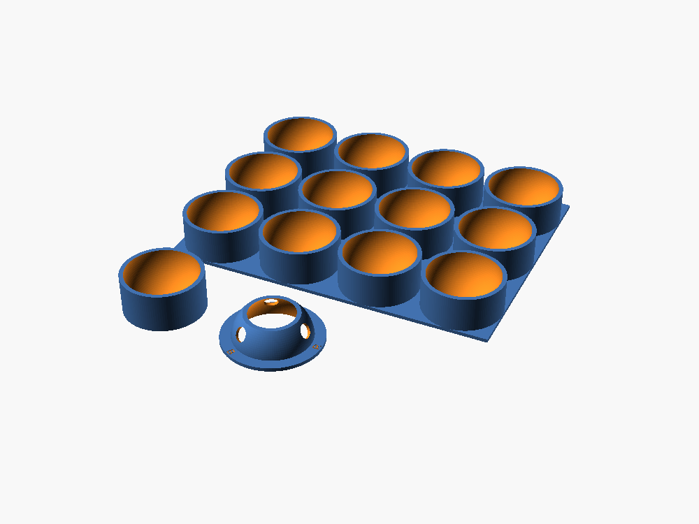

# Ball Marker

3D-printed tools to mark table tennis balls the way the spin meter reads them best, quickly
and the same on every ball. Plain balls can't be read (the ball's turn is invisible), and marking
by hand is slow and uneven.

**The marking** (from the spin meter, `experiments/02-spin-meter/web/README.md`, "Colour dots"):
- one half black;
- on the white half, three solid dots, about 8 mm across: red, green and blue;
- each 1 cm from the black/white line, at 12, 4 and 8 o'clock (120 degrees apart).

The black half gives the spin over a full turn; a dot seen in a few frames gives it from a quarter
turn, so short flights and awkward axes still read (with dots: 15 of 15 test serves found, against
11 of 13 with the black half alone).

## The tools

| Part | File | What it does |
|---|---|---|
| Cup | `stl/cup.stl` | Holds the ball in to exactly its middle (its rim is level with the ball's middle). Paint or marker the half that shows; a marker tip resting on the flat rim draws the line. |
| Tray | `stl/tray.stl` | 12 cups (3 x 4, 191 x 143 mm), for a batch with spray paint. |
| Dot stencil | `stl/cap.stl` | An open ring with three holes, labelled R, G and B. It sits on the cup over the white half and hugs the ball, so it centres itself; it can face any way round, since only the dots' height from the line and their spacing matter. |

## Marking a ball

1. **Black half.** Put the ball in the cup. Colour the half that shows: a black paint marker
   (Posca PC-5M or similar) or a permanent marker, its tip resting on the cup's rim for the line,
   then fill in. For a batch: balls in the tray, light coats of black spray paint, from above.
   Let it dry (paint markers: about 10 minutes).
2. **Dots.** Turn the ball over: black half down in the cup. Put the stencil on, brim flat on the
   cup. Dab a red paint marker through the R hole, green through G, blue through B; fill each hole.
   Lift the stencil straight up.
3. Let it dry before play. Keep the paint thin: a heavy coat adds weight to a 2.7 g ball.

With a two-tone training ball (e.g. JOOLA Spinball, white and orange), skip step 1: put the
orange half down and add the dots. The meter hasn't been tested on the orange half yet (see the
business plan's experiment E2).

## Printing

PLA or PETG, 0.2 mm layers, 15% infill, no supports. Print the cup and the tray open side up, the
stencil brim down (its ring stops 46 degrees up the ball, so it never leans past what prints
cleanly). Print time on a typical printer is short for the cup and stencil, longer for the tray.

Checked in software (`trimesh`, on the exported STLs): all three are closed solids; a 40.2 mm ball
rests in the cup with its middle exactly at the rim (22.1 mm) and 0.3 mm clearance; the stencil
clears the ball by 0.3 mm; each hole's centre lands 10.0 mm from the line on the ball, 120 degrees
apart. Not yet printed.

## Changing it

`ball_marker.scad` (OpenSCAD) holds every size as a setting: the ball (`ball_d`, 40+ balls are
40.0-40.6 mm), the clearance (`clear`; loosen it if your printer prints holes tight), the dot size
and distance from the line, the tray's rows and columns. Export a part:

    openscad -D 'part="cup"' -o cup.stl ball_marker.scad      # part: cup, tray, cap, layout
